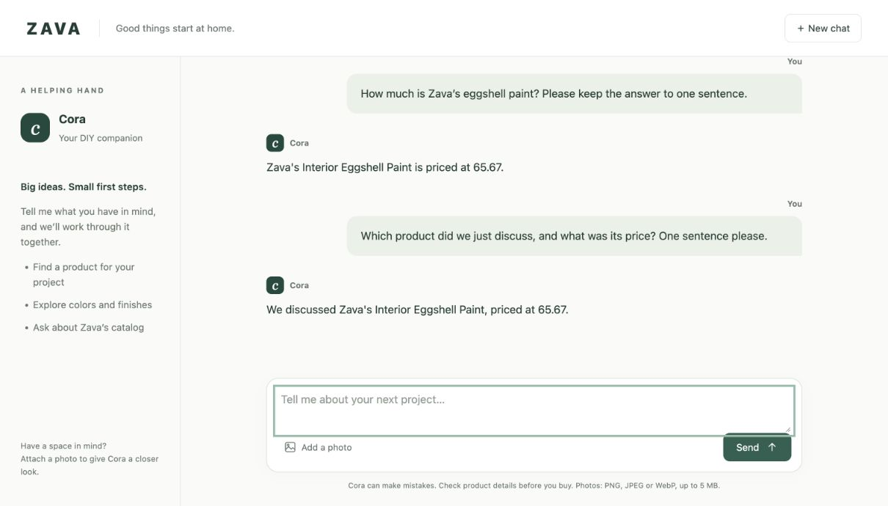

# Cora DIY Agent

A local, multimodal chat app for home-improvement advice, backed by a real product catalog. Cora uses Microsoft Agent Framework, an Azure OpenAI deployment, and a PostgreSQL catalog exposed through MCP tools.

An independent extension of [Microsoft Ignite 2025 LAB512](https://github.com/microsoft/ignite25-LAB512-prototyping-multimodal-agents-with-microsoft-foundry-and-the-ai-toolkit), taking the lab's exported agent from a terminal script to a working browser prototype.



## What it does

- Streams responses into a responsive browser chat interface.
- Searches the sample Zava catalog for product names, prices, and inventory.
- Remembers earlier turns within the current conversation.
- Accepts PNG, JPEG, and WebP photos up to 5 MiB when the model supports image input.
- Keeps separate browser-page conversations isolated and supports **New chat**.
- Handles timeouts, failed calls, expired sessions, and concurrent sends.

There is no frontend build step. The interface is plain HTML, CSS, and JavaScript, served by FastAPI.

## How it works

```text
Browser chat + optional photo
            │
            ▼
FastAPI: conversation sessions + streamed responses
            │
            ▼
Cora · Microsoft Agent Framework
      ├── Azure OpenAI model
      └── MCP over stdio → customer-sales tools → PostgreSQL
```

The server retains the complete tool conversation in an Agent Framework session. A turn is committed only when it finishes successfully. Streamed text follows the SDK's append/replace semantics, so the final text snapshot does not duplicate the visible response.

## Prerequisites

- **Python 3.13**; this is the version used for verification.
- **Docker** with Docker Compose for the sample PostgreSQL database.
- **Azure CLI**, installed and available on your `PATH`.
- An existing **Azure OpenAI resource** and a model deployment you can invoke. The lab uses `gpt-5-mini`; use an image-capable deployment for photo questions.
- Your Azure account needs permission to invoke that resource, typically the **Cognitive Services OpenAI User** role.

This repository does not provision Azure resources. Azure model calls incur charges on your subscription. The browser app and sample database run locally.

## Quick start

### 1. Clone and install

```bash
git clone https://github.com/thsonvt/cora-diy-agent.git
cd cora-diy-agent
python3.13 -m venv .venv
source .venv/bin/activate
python -m pip install -r requirements.txt
cp .env.example .env
```

On Windows PowerShell, activate with `.venv\Scripts\Activate.ps1` and copy the configuration with `Copy-Item .env.example .env`.

### 2. Configure your deployment

Edit `.env`:

```dotenv
AZURE_OPENAI_ENDPOINT=https://YOUR-RESOURCE.openai.azure.com
AZURE_OPENAI_DEPLOYMENT=gpt-5-mini
```

Use the **Azure OpenAI resource endpoint**, not a Foundry project endpoint ending in `/api/projects/...`. The deployment name must match your deployment, which may differ from the underlying model name.

Keep the example `POSTGRES_URL` for the provided local database. `.env` is ignored by Git. Azure authentication uses `DefaultAzureCredential`; no API key is required for the documented Azure CLI flow.

### 3. Start the sample database

```bash
docker compose up -d --wait
docker compose logs db
```

On its first start, the database restores Microsoft's bundled public lab backup. Wait for **“Zava PostgreSQL Database initialization completed!”** in the logs before sending a catalog question. The backup is sample lab data, not your Azure data or a copy of a live application database.

The database listens on `127.0.0.1:15432`. If that port is occupied, change both `POSTGRES_PORT` and the port inside `POSTGRES_URL` in `.env` before starting Compose. The Compose project has its own volume and does not reuse the original lab's database.

### 4. Sign in and launch

```bash
az login
python src/python/cora-web.py
```

Open **[http://127.0.0.1:8000](http://127.0.0.1:8000)**. Keep the server terminal running.

If you use a remote development environment, authenticate **inside the same environment where Python runs**, then privately forward port `8000` to your browser. A host-machine Azure login does not automatically sign a Dev Container in.

## Try a conversation

1. Ask: **“How much is Zava's eggshell paint?”**
2. Follow up: **“Which product did we just discuss, and what was its price?”**
3. Select **Add a photo**, attach [`img/demo-living-room.png`](img/demo-living-room.png), and ask for a paint recommendation based on the room.
4. Select **New chat** to clear the conversation.

Use **Enter** to send and **Shift+Enter** for a new line. Starter cards fill the composer so you can edit the question before sending.

Prices and inventory come from the sample database. The sample does not establish a currency; do not assume a currency that the catalog does not specify.

## Tests and verification

Run the HTTP tests without Azure credentials or model calls:

```bash
python -m unittest discover -s src/python/tests -v
```

The suite covers chat history, isolation, reset, upload forwarding and rejection, authentication errors, failure rollback, timeout recovery, concurrent requests, turn limits, and final streaming snapshots.

The UI was also checked in Chrome at desktop and phone-sized layouts, with a real catalog lookup and a follow-up that retained the product and price. Photo upload forwarding is tested; live image-understanding quality has not been evaluated.

## Project layout

```text
src/python/
  cora-app.py                 Shared agent configuration and CLI examples
  cora-web.py                 FastAPI server and streaming endpoints
  static/cora.html            Browser interface
  tests/test_cora_web.py      HTTP regression checks
  mcp_server/customer_sales/  Catalog MCP server and PostgreSQL adapter
data/                        Original public lab database backup
scripts/init-db.sh           Original lab database initialization
img/demo-living-room.png     Original example room photo
compose.yaml                 Local sample database
.env.example                 Public configuration template
```

The standalone export omits the original workshop's other exercises, VS Code configuration, personal cloud settings, cached credentials, and local agent/session history. The running browser app and its catalog integration are the focus.

## Troubleshooting

| Symptom | What to check |
| --- | --- |
| Missing `AZURE_OPENAI_ENDPOINT` | Copy `.env.example` to `.env` and set your resource endpoint. |
| Azure sign-in error or interrupted reply | Run `az login` in the same environment as the server. The page preserves your draft so you can resend it. |
| Deployment not found or access denied | Check the endpoint, deployment name, selected tenant, and your permission to invoke the resource. |
| Database connection or catalog error | Confirm database initialization completed, `docker compose ps` shows a healthy database, and `POSTGRES_URL` matches its host and port. |
| Port `15432` is occupied | Change `POSTGRES_PORT` and the port in `POSTGRES_URL` together. |
| Port `8000` is occupied | Run `python src/python/cora-web.py --port 8001` and open that port instead. |
| Chat expired | Start **New chat**. Idle sessions expire after one hour. |
| Unexpected error | Inspect the server terminal for the traceback; internal error details are not sent to the browser. |

Database initialization runs only when its Docker volume is empty. Changing initialization files does not reinitialize an existing volume. `docker compose down` stops the database while keeping its data; adding `--volumes` deletes the local sample database.

## Prototype boundaries

- Conversations live in memory, allow 40 completed turns, and disappear when the server restarts. A page reload starts a new conversation.
- Model calls have a 120-second timeout. Failed turns are excluded from the saved model history.
- Photos are sent to your configured Azure model and are not written to disk by the app. Avoid uploading sensitive images.
- This is a local learning prototype with no user accounts or production authentication. Keep its web port private.
- The database uses published demo credentials. They are fixtures, not production secrets. The MCP tools use the lab's default identity; this app is not an authorization or tenant-isolation reference.
- Recommendations depend on model behavior and sample catalog data. Verify product details before using them for a real purchase or DIY project.

## Contributing

Bug reports and focused pull requests are welcome. Include reproduction steps and your Python/SDK versions. Run the HTTP suite before submitting a change. Do not commit `.env`, credentials, private datasets, or Azure account files.

To report a sensitive issue, avoid including credentials or private data in a public issue. Use GitHub's private vulnerability reporting option if it is available on the repository.

## Credits and license

Based on [Microsoft's Ignite 2025 LAB512 sample](https://github.com/microsoft/ignite25-LAB512-prototyping-multimodal-agents-with-microsoft-foundry-and-the-ai-toolkit), especially its [Migrate to Code exercise](https://github.com/microsoft/ignite25-LAB512-prototyping-multimodal-agents-with-microsoft-foundry-and-the-ai-toolkit/blob/main/lab/instructions/05_Migrate_to_Code.md). The exported Cora instructions, MCP catalog integration, database fixtures, and room image come from that sample. This adaptation adds the browser app, session handling, streaming support, tests, and standalone setup.

Code is **MIT licensed**; the original Microsoft notice is retained in [LICENSE](LICENSE). This README and inherited instructional content are available under **CC BY-SA 4.0**, whose full text is preserved in [LICENSE-DOCS](LICENSE-DOCS). See [NOTICE](NOTICE) for provenance. This independent project is not an official Microsoft product.
